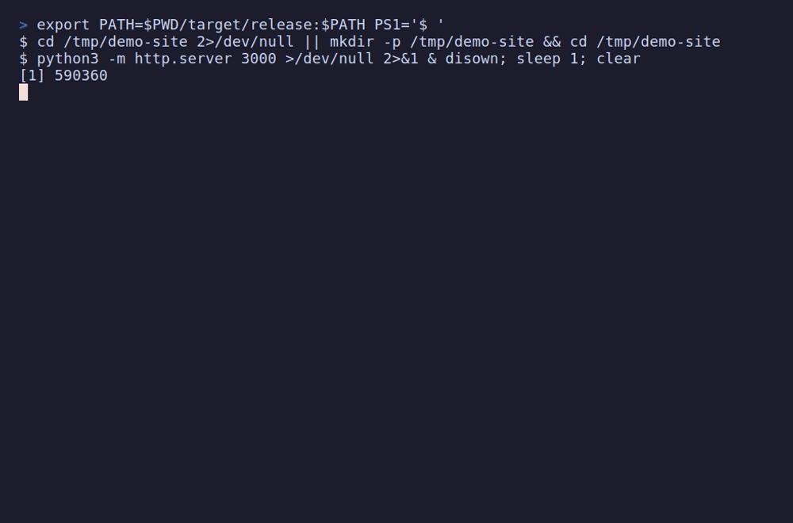

# whoisport

[](https://crates.io/crates/whoisport)
[](https://github.com/dpologdvinity/whoisport/actions/workflows/ci.yml)

Find out what is listening on a TCP port, and optionally kill it.



```console
$ whoisport 3000
port    3000
pid     373232
parent  373230
user    kaitlyn
cmd     node node_modules/.bin/vite --port 3000
cwd     /home/kaitlyn/site
uptime  4m 12s

$ whoisport 3000 --kill
...
pid 373232: exited after SIGTERM

$ whoisport
PORT   PID      USER       CMD
3000   373232   kaitlyn    node node_modules/.bin/vite --port 3000
5432   ?        ?          ?
8080   41120    kaitlyn    python3 -m http.server 8080
ports marked ? are owned by another user; run with sudo to see it
```

`lsof -i :3000` gives you a PID and a wall of columns. `whoisport` gives you the
command line, the directory it was started from, who owns it and how long it has
been running, which is usually what you need to decide whether to kill it.

## Install

```sh
cargo binstall whoisport   # prebuilt binary, no compiling
cargo install whoisport    # build from source
```

Or download a binary from the
[Releases page](https://github.com/dpologdvinity/whoisport/releases): static Linux
builds for x86_64 and aarch64, and a Windows x86_64 `.exe`.

Works on **Linux** (reads `/proc` directly, no runtime dependencies) and
**Windows 10/11**.

## Usage

```
whoisport                          # list every listening port
whoisport <PORT>...                # details for one or more ports
whoisport <PORT>... --kill [--force]
whoisport [<PORT>...] --json       # machine-readable output
```

| Flag      | Effect                                                              |
|-----------|---------------------------------------------------------------------|
| `--kill`  | Ask the process to exit and wait up to 3 seconds.                   |
| `--force` | With `--kill`: forcibly terminate it if asking did not work.        |
| `--json`  | Print a JSON array with `port`, `pid`, `ppid`, `user`, `cmd`, `cwd`, `uptime_secs`. |

`--kill` always needs explicit ports; it never kills everything.

How `--kill` asks, per platform:

| Platform | `--kill`                                                        | `--force`          |
|----------|-----------------------------------------------------------------|--------------------|
| Linux    | `SIGTERM`                                                       | `SIGKILL`          |
| Windows  | Ctrl+C in the process's console, and `WM_CLOSE` to its windows  | `TerminateProcess` |

On Windows the Ctrl+C reaches every program in that console, exactly as if you
pressed Ctrl+C in that terminal window.

Exit codes: `0` success, `1` a requested port had nothing listening (or nothing
is listening at all), `2` invalid arguments, `3` a kill failed.

Checks IPv4 and IPv6 TCP sockets in the LISTEN state. On Linux, processes owned
by other users can't be inspected without `sudo`; they show up as `?`. On
Windows, details of system services need an elevated terminal.

## Not yet supported

UDP, macOS, Docker port-mapping awareness.

## License

MIT
